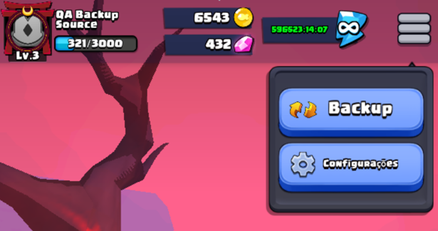
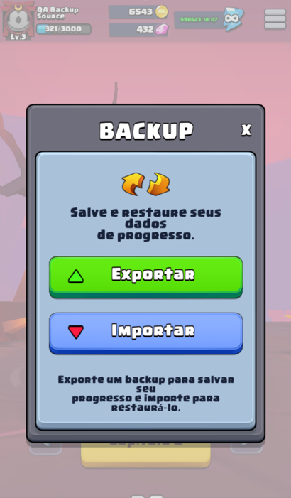

# Backup manual nativo — v141, 06/11/2026

Build normal: `v141-native-manual-backup`, package `com.habby.kinjarun.offline.audit1`, jogo 1.9.1/code 51, bridge ARM64, mesmo certificado de laboratório. APK SHA-256 `A382CDCFF5D740CFBBF51689DE00EA655F8FCC12A3D8FC44EA4C87027A711C27`; biblioteca `9DC7DB3AF04F74ED56D69162AE10A9E5AB4DBF82446A327BE072BFB3222F4103`. Compilação ARM64, Java/D8, empacotamento e assinatura v1/v2/v3 passaram. **A normal não foi instalada no perfil do usuário**; os testes de interface/restauração ocorreram exclusivamente nos packages QA Source e Destination abaixo. O acervo externo foi somente lido.

## Problema reproduzido e interface

O relato do usuário sobre a v131 foi confirmado: abrir Configurações causava SIGSEGV em UnityMain/Houdini. A v132 de rastreio entrou no hook DoOpen e caiu ao retornar pelo trampoline, antes da captura de preferências. Retirar os hooks de UISetting permitiu abrir Configurações novamente na v133. Isso estabelece o ponto da falha nesta configuração; não estabelece um defeito geral de Houdini em outros aparelhos. V134–137 foram tentativas intermediárias, com problemas de entrada, resolução de overload, tradução herdada e ordem dos painéis; não são builds finais.

O menu real está em `UIMainPanel/Content/Page/Main/Top/StoragePanel/imgStorageBg/btnSetting`. `RightShrink` era outro caminho. O inspetor somente leitura `tools/bundles/inspect_backup_ui.py` usa os bundles originais `clientgameobjectsui78.ht` e `clientgameobjectsui5f.ht` e a UnityPy já disponível no acervo; não reempacota prefabs.

`backup_ui.h` clona o botão original por NGUITools.AddChild, amplia seu fundo para 276×246 e coloca Backup acima de Configurações, preservando a ligação original deste último. Fonte, atlas Common_N, bordas e botões vêm do jogo. O ícone usa as setas de sincronização existentes; não representa serviço de nuvem. A janela funcional tem título, descrição, Exportar verde, Importar azul e instrução inferior. Fecha pelo X, toque externo e Voltar do Android. O painel ativa `useSortingOrder` e aplica depth/sortingOrder acima dos painéis ativos: só alterar a propriedade sortingOrder não basta no NGUI deste APK.

Os cliques usam um delegate gerenciado original para `UIMainPanel.OnClickStorageBg` (`0xFCA444`), com hash/prólogo guardados e a operação original de ocultar StoragePanel preservada para cliques normais. A construção ocorre no fluxo Unity de UIMainPanel.DoOpen já existente. **Não há hooks em UISetting.DoOpen/DoClose.** Back Android é encaminhado pela fila original UnityPlayer.queueGLThreadEvent, com conferência do TID UnityMain antes de chamar APIs Unity. Campos são acessados por APIs IL2CPP/reflection originais, nunca por escrita em offsets.

Capturas reais do QA restaurado, recortadas e reduzidas apenas para documentação:

## Dados e formato 2

Contêiner `.kinjabak`, sem compressão ou conteúdo executável. Layout big endian: magic ASCII `KINJABKP` (8 bytes), Int32 **2**, string DataOutputStream.writeUTF de compatibilidade, Int32 de quantidade, entradas nome/writeUTF + Int32 de tamanho + bytes UTF-8 JSON, e SHA-256 binário de todos os bytes anteriores (32 bytes). A compatibilidade é `kinja-1.9.1-7953eb369ba9b8c814c4736dac4a7e3aa116a5583837f6f12d795ea70c20595e/offline-save-1`. A versão 1 é recusada explicitamente; não há migração silenciosa.

| Entrada | Conteúdo restaurado |
|---|---|
| `seed_player.json` | Conta local, nome, nível/EXP, moedas, energia, status, ícone e contadores |
| `seed_regions.json` | Seleção/máximo, capítulos/regiões, vitórias, pontuações e derrotas |
| `seed_items.json` | Inventário de materiais, chaves, fragmentos, livros e demais itens |
| `seed_equipment.json` | UID, item, parte, nível, qualidade e condição equipada |
| `seed_talents.json` | Talentos normais e extras |
| `seed_heroes.json` | Heróis possuídos/equipado, nível, estrelas e talentos |
| `seed_guide.json` | Tutorial já persistido pelo bridge |
| `seed_shop_chests.json` | Contadores, grupos e estados locais dos baús |
| `hangup_local_state.json` | Coletas/dia/voltas rápidas, opcional |
| `shop_daily_claim.json` | Resgate diário local, opcional |
| `local_preferences.json` | Entrada virtual de preferências lógicas via APIs originais |

São obrigatórios oito seeds e preferências; os dois ledgers são opcionais, com ausência preservada. Não se presume um único save. Respostas estáticas de combate/revive são assets do APK. Partida em andamento, `last_fight`, caches, SDKs, tokens, XML bruto cifrado, IDs de dispositivo, credenciais, journals, arquivos temporários e marcadores QA não são exportados. Nome local é parte do perfil. Marcadores QA preexistentes no destino são preservados somente em armazenamento privado para evitar reaplicar fixtures; nunca vêm do backup.

Preferências de inteiro/bool: `{Key,Present,Value}` para `1fight_fail_count`, `1drop_die_hint`, `boxguide_close_1`, `_manga_state`, os 700 `fail_region_<id>` exatos do catálogo e `game_language` (0–15). Float acrescenta `Type:"float"`; Value é o UInt32 dos bits IEEE754 binary32, preservando precisão para `sound_volume`, `music_volume` e `operation_sensitivity`. Valores finitos 0–1; defaults ausentes 1, 1 e 0.33f. Presença/ausência é restaurada, inclusive removendo valores existentes só no destino. AudioManager usa setters originais e readback para atualizar caches.

**Idioma aprovado pelo usuário:** escolha explícita é restaurada; quando `game_language.Present=false`, mantém a chave ausente e resolve o idioma do sistema do **destino**, pelo mapeamento exato de Init.LanguageSet 1.9.1 e Application.get_systemLanguage. O Value exportado nesse caso registra apenas o idioma efetivo de origem. ConfigTool.CurrentLanguageIndex usa API IL2CPP de campo estático e readback. `seed_player.Lang` é o campo do modelo local original, não substitui essa regra da interface.

Validação integral antes de confirmação e novamente no cold start: SHA-256, versão/cliente, 9–11 nomes permitidos e únicos, arquivos obrigatórios, máximo 128 KiB por entrada e 12×128 KiB na leitura total; UTF-8 estrito, profundidade até 24, tipos/limites/arrays, chaves duplicadas e metadados `$` recusados. Catálogo exato de IDs/níveis/qualidade/estrelas, UID único, parte equipada única e referências de herói/região são conferidos. SHA-256 detecta corrupção, **não autentica autoria**. Não aceita saves de outra versão apenas por renomear a extensão. Operações de progresso com journals pendentes bloqueiam a exportação.

## Exportação e substituição

Exportar captura preferências e arquivos sincronamente no clique na thread Unity, sem intercalar callbacks de progresso. Abre ACTION_CREATE_DOCUMENT local, escreve, flush/fsync, fecha, reabre e compara os bytes completos e o formato. Só então anuncia sucesso. Falha produz erro e tenta remover o documento incompleto; provedores que não permitem remoção podem deixar esse arquivo, sem sucesso anunciado. Cancelar o seletor não altera o perfil. Não pede acesso amplo ao armazenamento.

Importar usa ACTION_OPEN_DOCUMENT local, lê com limite e valida tudo antes de mostrar a confirmação. Cancelar preserva o save. Confirmar grava/confere uma solicitação privada imutável e fecha o processo. É necessário reabrir o jogo. Antes de Unity/configure, BackupStore valida de novo, cria/confere a recuperação, prepara o diretório completo com fsync/readback, registra prepared, renomeia o diretório anterior e o novo e registra applying. Não grava cada seed por cima do save vivo.

Na thread Unity, o estado lógico anterior de preferências é gravado e conferido antes de qualquer Set/Delete; o primeiro checkpoint concluído é imutável inclusive se AccountInit repetir no mesmo processo após falha. Todos os modelos são deserializados antes dos callbacks originais. Somente após inicialização original bem-sucedida há committed e mensagem de sucesso. Um cold start com prepared/applying não confirmado valida e restaura o diretório inteiro anterior e seu checkpoint de preferências. Estado incerto bloqueia Unity em vez de continuar com save parcial. A geração anterior permanece privada para recuperação; não é backup portátil permanente.

## Testes realizados

BlueStacks Desktop 16.0.0.34, Android 16/API36 x86_64, tradução ARM64 Houdini, device `127.0.0.1:6610`. Apenas `com.habby.kinjarun.offline.qa.backup.source` (v138) e `.destination` (v140) receberam testes de escrita/restauração. V139 foi substituída antes de uso. Fixture Source artificial: nível3/EXP321/ouro6543/gemas432, regiões1–7, herói4002 nível3 estrela2 e herói1001, equipamento3002 nível5 qualidade2 equipado, talentos2, itens6001×134/20001×3/1002×5. Destination começou nível1/EXP0/ouro1500/gemas0, inventário/equipamento vazios. Build fixture só permite seus packages QA exatos e não se combina com outras fixtures. A normal tem `backupFixture=None`.

| Caso | Resultado observado |
|---|---|
| Backup acima de Configurações | Passou, botão nativo e painel ampliado |
| Abrir/fechar/reabrir | Passou por X, toque externo e Voltar Android |
| Configurações após Backup | Abriu, desligou música e fechou sem crash |
| Exportação SAF | Dois arquivos de origem e um de destino gravados/conferidos, sucesso observado |
| Cancelar importação válida | Confirmação cancelada; destino manteve nível1/1500/0 e inglês |
| Arquivo inválido | 12 bytes de texto recusados com erro, sem confirmação/substituição |
| Versão incompatível | Versão999 com SHA recalculado recusada com mensagem específica |
| Importação válida | Fechou após confirmação, reabriu, carregou e anunciou sucesso |
| Dados restaurados | HUD nível3/321/6543/432/capítulo6; tela de equipamento exibiu herói nível3 e equipamento nível5 |
| Configurações | Música desligada; destino antes em inglês voltou ao português do sistema porque origem não tinha escolha explícita |
| Conferência integral | Reexportação do destino: **todos os 10 registros e arquivo completo idênticos byte por byte** à origem |
| Reinício completo | force-stop/reabertura do QA destino manteve valores e permitiu navegar no equipamento/menu |
| Host | 1943 verificações, 80 cenários de falha em 40 pontos de write/rename/sync, incluindo exportação parcial/readback inválido, erros e interrupções simuladas, recuperação e replay de preferências |
| Android ART isolado | A mesma suíte passou: 1943 verificações/80 cenários/40 pontos, com fsync real de arquivos/diretórios e Os.rename, somente em arquivos artificiais de `/data/local/tmp` |

Backup final da origem e reexportado: 41732 bytes; ambos SHA-256 `F37CDCE6B32C53F3063002E2B0CC04CC15EE6B9F54D6B0662E7C9E68644FF2EE`. Incluiu oito seeds, hangup e preferências. O resgate diário estava ausente nos dois; seu caso presente é coberto pelas fixtures de testes, não por resgate real nesta rodada.

O runner ART usa BackupStore/BackupCatalog de produção e a suíte compilada em DEX via app_process, sem instalar app ou acessar saves privados. As falhas são IOException e Error injetados antes de operações de disco; a reabertura é simulada por outra instância. Não é morte real do processo nem corte de energia. Sandbox exclusivo retido: `/data/local/tmp/kinja-backup-qa-20261106-142307-fa0895bc42f44668b51a1b6a839915fb`. Síntese e hashes em `MANUAL_BACKUP_V141_RESULTS.json`.

## Reprodução e limites

1. Atualizar o APK normal mantendo package/certificado. Não desinstalar para atualizar um perfil existente.
2. Na home: três linhas → Backup → Exportar → escolher pasta/Salvar. Guardar o `.kinjabak` fora da pasta privada do jogo.
3. Em versão compatível: Backup → Importar → selecionar arquivo → conferir o aviso. Cancelar ou confirmar; ao confirmar, reabrir o jogo e aguardar resultado.
4. Para regressões isoladas no host: `./tests/backup/run.ps1`. Fixtures nunca apontam para saves reais.
5. Para a suíte ART em sandbox novo: `./tests/backup/run-android.ps1 -Serial <serial-adb>`. Requer API26+, dependências configuradas e ADB; não remove o sandbox automaticamente.

Não houve restauração no perfil pessoal, instalação da normal v141, teste em dois celulares físicos, reinstalação real, corte de energia/controlador de armazenamento, run completa pós-restauração nem validação de provedores SAF de terceiros. Preferências ObscuredPrefs não zero e idioma explicitamente escolhido são cobertos no codec/fluxo original, mas não tiveram um segundo caso de transferência visual específico nesta rodada. Não confundir falhas simuladas de I/O com corte físico de energia.

Tutorial preserva apenas o que o bridge já salva: SyncLocalData/UpdateGuideId online permanece uma limitação anterior, sem correção adicional nesta tarefa. Dados dependentes de servidor não são recriados nem tornam anúncios/compras/login disponíveis. O backup cobre o perfil local restaurável inventariado acima, não funcionalidades online ou retomada de uma luta em andamento.

Limpeza final executada por `tools/workspace/clean-builds.ps1 -KeepBuildId v141-native-manual-backup`: 8067491580 → 376019611 bytes. Somente APK normal assinado e relatório de assinatura permanecem em `build`; IDs/hashes v132–v141 foram preservados em `docs/development/build-history.json`. Evidências brutas locais removidas após esta síntese; sandbox ART artificial no Android e packages QA permanecem. Nenhum acervo externo, dependência, chave/senha ou save pessoal foi limpo.
